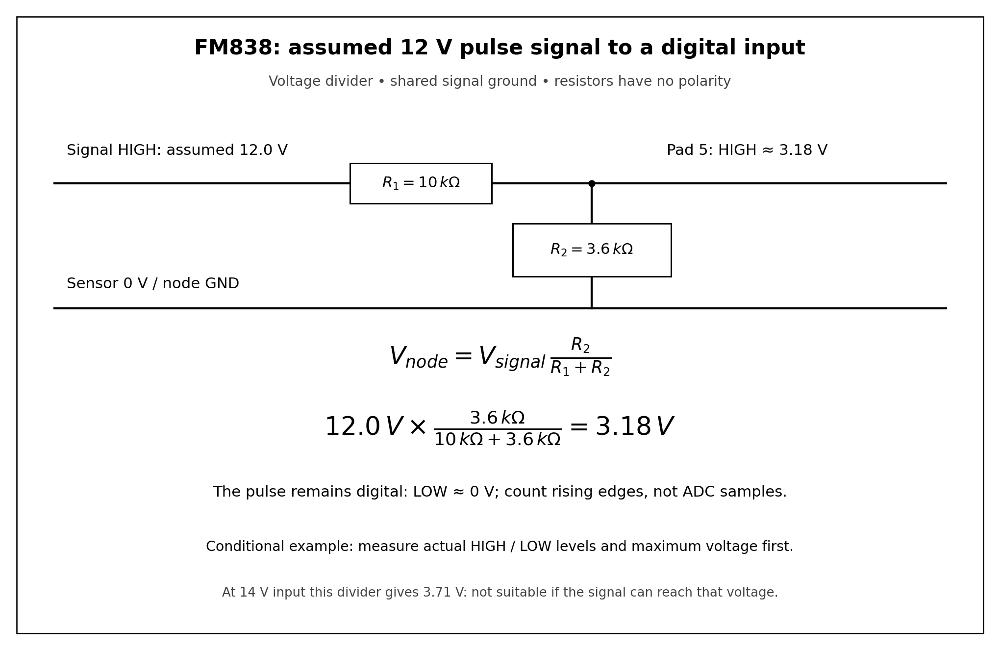

# FM838 flow-meter pulse input

[Vector diagram](wiring.svg) · [Node 80 wiring](../../node-80.md)

For the Deutsch connector, **A/red is supply, B/white is signal, C/black is ground**. Sensor power is separate. The proposed signal route is B → divider → node-80 physical pad 5 / PA15 / GPIO54, with C and node ground joined. This is a **digital pulse input**, not an ADC measurement; firmware counts edges to determine flow.

## Conditional 12 V example

The local TeeJet sheet specifies a 50% square wave but does not establish its HIGH voltage or output-stage type. The circuit below assumes a driven 0–12 V signal and is **not approved for connection until actual signal levels and maximum voltage are confirmed**. An open-collector output may instead permit a suitable 3.3 V pull-up, depending on its electrical specifications.

$$V_{HIGH,node}=12.0\,V\times\frac{3.6\,k\Omega}{10\,k\Omega+3.6\,k\Omega}=3.176\,V\approx3.18\,V$$

This corrects the second PowerPoint equation, which mistakenly used 5 V and reported 3.21 V. At a 5 V signal the same divider gives only 1.324 V; at 14 V it gives 3.706 V. Neither is an acceptable substitute for confirming the actual pulse levels. Verify both LOW and HIGH against the selected GPIO's input thresholds and voltage limits.

| R1 | R2 | Node HIGH at exactly 12 V | Note |
|---|---|---:|---|
| 10 kΩ | 3.6 kΩ | 3.176 V | Corrected PowerPoint example; little overvoltage margin |
| 10 kΩ | 3.3 kΩ | 2.977 V | More headroom; still check worst-case HIGH and LOW |
| 12 kΩ | 3.9 kΩ | 2.943 V | Alternative nominal ratio |

These are calculations for a confirmed 12 V signal, not guarantees over the sensor's full supply range. A digital divider must keep maximum voltage safe while still exceeding the GPIO's minimum HIGH threshold at the lowest signal HIGH. A multimeter may display the average of a pulse train; use an oscilloscope or a valid static-HIGH measurement to establish pulse amplitude.

## Flow conversion

For the local FM838 revision, the listed nominal coefficient is 362 pulses/litre. Use the unit's label and field calibration as the final coefficient K:

$$Q_{L/min}=\frac{60f_{Hz}}{K_{pulses/L}}\qquad Volume_L=\frac{N_{pulses}}{K_{pulses/L}}$$

## Choosing different divider resistors

`R1` is between the sensor signal and node input. `R2` is between that input junction and common ground. The node measures the junction voltage. Resistor ratios set the voltage; their absolute values set loading and source impedance, so do not scale them arbitrarily without checking the sensor and node input requirements.

$$V_{node}=V_{signal}\frac{R_2}{R_1+R_2}$$

Choose an upper resistor R1, the **maximum possible signal voltage**, and a target below 3.3 V, then calculate:

$$R_2=R_1\frac{V_{target}}{V_{signal,max}-V_{target}}$$

After rounding to available resistor values, substitute those actual values back into the first equation. With fractional resistor tolerance t (for example, 0.01 for 1%), check the highest possible junction voltage:

$$V_{node,max}=V_{signal,max}\frac{R_2(1+t)}{R_1(1-t)+R_2(1+t)}$$

Keep that result below 3.3 V with margin. Measure the completed divider before connecting the node. These diagrams show basic signal conversion, not additional fault-protection circuits.

## Sources

Circuit style reconstructed from slide 4 of the supplied `HardwareLayout.pptx`; source deck unchanged. Pinout/calibration: the supplied TeeJet `98-01628-ENUS-R0_A4LT-FM838-TurbineFlowmeter-TB.pdf`. Pulse amplitude still requires verification.

## Items to complete

- [ ] Confirm signal HIGH/LOW voltage and output-stage type; choose and verify the divider or pull-up accordingly.
- [ ] Implement edge counting, configurable pulse calibration, rate/total volume, and CAN/PX4 telemetry.
- [ ] Confirm the unit-specific calibration coefficient and perform a measured-volume calibration; test zero flow and disconnect behavior.
