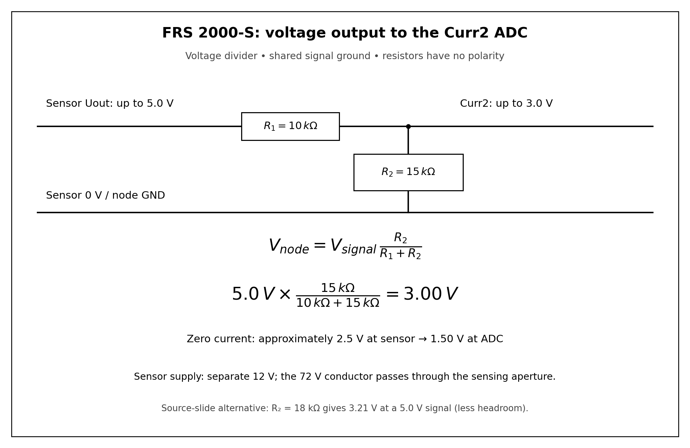

# FRS 2000-S current sensor

[Vector diagram](wiring.svg) · [Node 80 wiring](../../node-80.md)

The proposed node-80 connection is **Uout → R1 (10 kΩ) → Curr2 junction → R2 (15 kΩ) → common ground**. Connect sensor supply return to node ground. Sensor power is separate 12 V; the measured 72 V conductor passes through the aperture and does not connect to the analog input. Curr2 maps to PB1 / ADC identifier 16, reserved but not yet enabled in the current firmware target.

## Worked example

$$V_{ADC}=5.0\,V\times\frac{15\,k\Omega}{10\,k\Omega+15\,k\Omega}=3.00\,V$$

The divider ratio is 0.6. The nominal 2.5 V zero-current signal becomes 1.50 V; nominal 0.5–4.5 V output becomes 0.30–2.70 V. Use the actual maximum output specification when checking headroom, not only the normal measurement endpoints.

| R1 | R2 | ADC at 5.0 V signal | ADC at nominal 2.5 V zero current |
|---|---|---:|---:|
| 10 kΩ | 15 kΩ | 3.000 V | 1.500 V |
| 10 kΩ | 18 kΩ | 3.214 V | 1.607 V |
| 12 kΩ | 18 kΩ | 3.000 V | 1.500 V |

The 10 kΩ / 18 kΩ combination reproduces the first PowerPoint example but leaves less headroom than the proposed 10 kΩ / 15 kΩ circuit. Values are nominal; include tolerances and maximum signal voltage in the final check. Use 1% or better resistors; resistor matching and calibration affect current accuracy.

## Recovering current from the ADC voltage

For the exact FRS 2000-S bidirectional version, nominal sensitivity is 2 V / 6000 A. Using the measured/calibrated zero-current voltage Vzero at the sensor:

$$V_{sensor}=V_{ADC}\frac{R_1+R_2}{R_2}$$

$$I_{primary}=\frac{V_{sensor}-V_{zero}}{2\,V/6000\,A}$$

Use the actual unit's calibration and current direction. Its 2000 A nominal range gives relatively coarse low-current resolution on this ADC; this circuit is not a precision low-current monitor.

## Choosing different divider resistors

`R1` is between the sensor signal and node input. `R2` is between that input junction and common ground. The node measures the junction voltage. Resistor ratios set the voltage; their absolute values set loading and source impedance, so do not scale them arbitrarily without checking the sensor and node input requirements.

$$V_{node}=V_{signal}\frac{R_2}{R_1+R_2}$$

Choose an upper resistor R1, the **maximum possible signal voltage**, and a target below 3.3 V, then calculate:

$$R_2=R_1\frac{V_{target}}{V_{signal,max}-V_{target}}$$

After rounding to available resistor values, substitute those actual values back into the first equation. With fractional resistor tolerance t (for example, 0.01 for 1%), check the highest possible junction voltage:

$$V_{node,max}=V_{signal,max}\frac{R_2(1+t)}{R_1(1-t)+R_2(1+t)}$$

Keep that result below 3.3 V with margin. Measure the completed divider before connecting the node. These diagrams show basic signal conversion, not additional fault-protection circuits.

## Source

Circuit style reconstructed from the conversion examples on slide 4 of the supplied `HardwareLayout.pptx`. Sensor characteristics: [LEM FRS-Sxx datasheet](https://www.lem.com/sites/default/files/products_datasheets/frs_1000___3000-sxx__v5.pdf). The source PowerPoint is unchanged.

## Items to complete

- [ ] Confirm the exact sensor variant/connector pinout and assemble/check the divider using measured resistor values.
- [ ] Enable Curr2 acquisition and implement current conversion, calibration parameters, and CAN/PX4 telemetry.
- [ ] Calibrate zero-current offset, gain, and direction against a reference; confirm that the available low-current resolution is sufficient.
