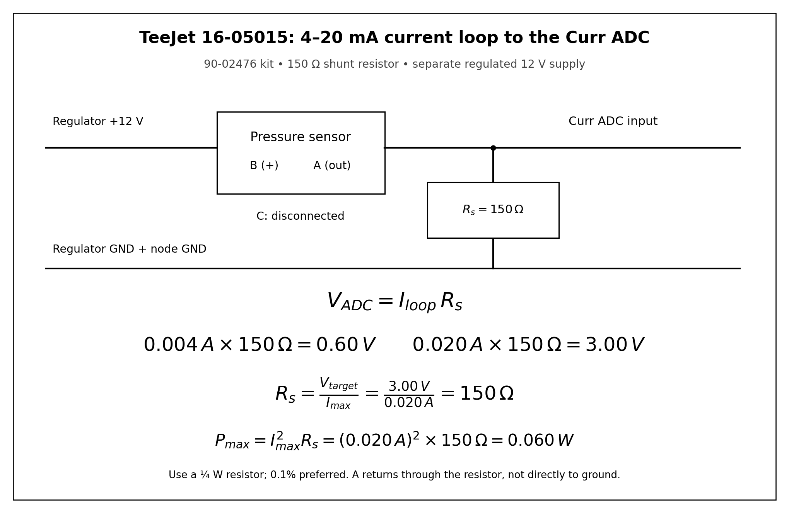

# TeeJet pressure transducer — 4–20 mA

[Vector diagram](wiring.svg) · [Node 80 wiring](../../node-80.md)

The 90-02476 kit contains the **16-05015** sensor shown in the supplied photos. Its label specifies **8–28 V supply, 4–20 mA output, and 0–10 bar**. Connect regulator +12 V to **B**. Connect **A** to the node Curr junction and the top of the shunt resistor. Connect the resistor's other end to regulator ground and node ground. **C remains disconnected.** There is no separate sensor ground pin: loop current returns through A and the resistor.

## Current-to-voltage conversion

This uses a single **shunt resistor to ground**, not the two-resistor voltage divider used by the other sensors. Curr maps to PA1 / ADC identifier 6.

$$V_{ADC}=I_{loop}R_s$$

$$V_{zero}=0.004\,A\times150\,\Omega=0.60\,V$$

$$V_{full}=0.020\,A\times150\,\Omega=3.00\,V$$

| Pressure | Loop current | Voltage with 150 Ω |
|---|---:|---:|
| 0 bar | 4 mA | 0.60 V |
| 5 bar | 12 mA | 1.80 V |
| 10 bar | 20 mA | 3.00 V |

## Choosing another resistor

Choose a full-scale target below the ADC limit:

$$R_s=\frac{V_{target}}{I_{max}}=\frac{3.00\,V}{0.020\,A}=150\,\Omega$$

| Shunt resistor | At 4 mA | At 20 mA | Nominal full-scale dissipation |
|---|---:|---:|---:|
| 100 Ω | 0.40 V | 2.00 V | 0.040 W |
| 120 Ω | 0.48 V | 2.40 V | 0.048 W |
| 150 Ω | 0.60 V | 3.00 V | 0.060 W |
| 160 Ω | 0.64 V | 3.20 V | 0.064 W |
| 165 Ω | 0.66 V | 3.30 V | 0.066 W; no margin, avoid |

A smaller resistor reduces voltage span and therefore measurement resolution, but leaves more voltage across the sensor. Check the highest expected current, supply tolerance, and resistor tolerance. With fractional resistor tolerance t:

$$V_{ADC,max}=I_{loop,max}R_s(1+t)$$

20 mA is the measurement endpoint, not a verified fault-current limit. The basic circuit shown does not include additional fault protection.

## Resistor power and sensor supply margin

$$P_{shunt}=I_{loop}^{2}R_s=(0.020\,A)^2\times150\,\Omega=0.060\,W$$

A ¼ W resistor has ample nominal power margin. Prefer 0.1% metal-film for accuracy; a measured/calibrated 1% part is also usable.

$$V_{sensor}=V_{supply}-I_{loop}R_s-V_{cable\ drop}$$

At 12 V supply and 20 mA, ignoring cable loss: `Vsensor = 12 − 3 = 9 V`, above the labeled 8 V minimum. Check the lowest actual supply voltage and cable drop before choosing a larger resistor.

## Recovering pressure

$$I_{loop,mA}=1000\frac{V_{ADC}}{R_s}$$

$$P_{bar}=10\frac{I_{loop,mA}-4}{20-4}$$

For the 150 Ω example this is equivalently:

$$P_{bar}=10\frac{V_{ADC}-0.60\,V}{3.00\,V-0.60\,V}$$

Calibrate zero/span for the actual sensor and resistor. Treat out-of-range readings as faults rather than assuming they are valid zero pressure. Pressure acquisition and telemetry still require firmware implementation.

## Source

Pinout and ratings read from the actual sensor label and TeeJet replacement-kit instruction sheet in the supplied photos. The diagram is newly drawn to match the supplied voltage-divider examples.

## Items to complete

- [ ] Assemble the shunt circuit, measure the resistor, and verify supply margin and signal voltage before connecting Curr.
- [ ] Implement pressure acquisition/scaling, configurable zero/span, fault handling, and CAN/PX4 telemetry.
- [ ] Check zero and calibrate span against a reference pressure gauge, then test disconnected/out-of-range readings.
